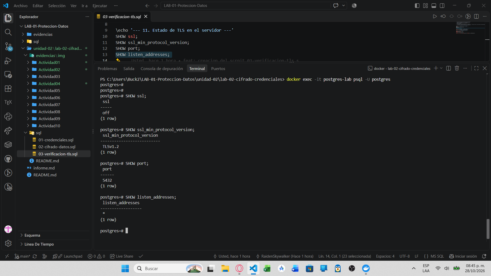
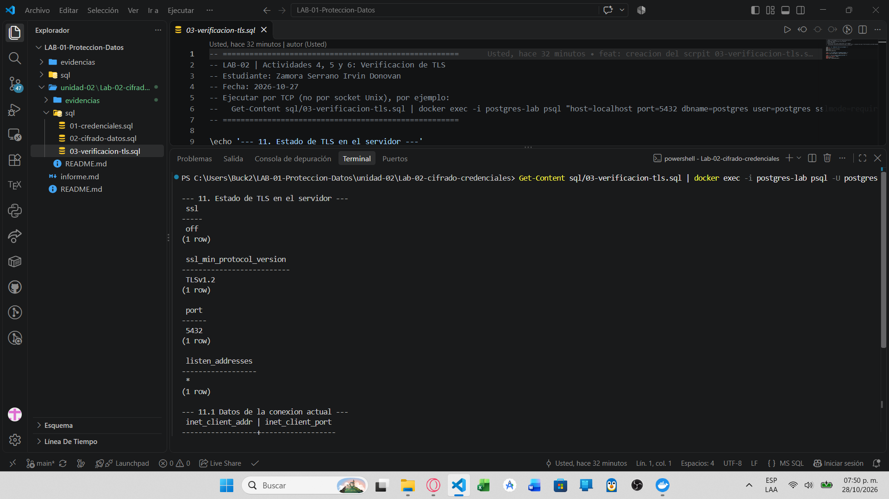
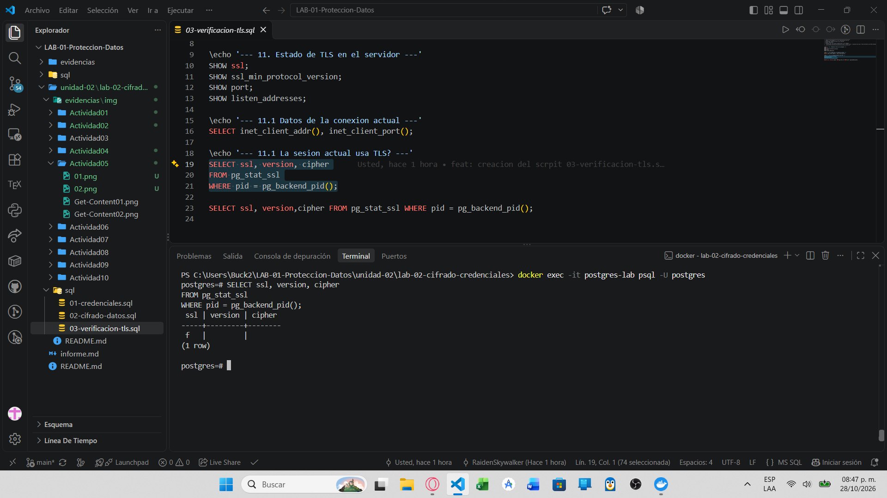
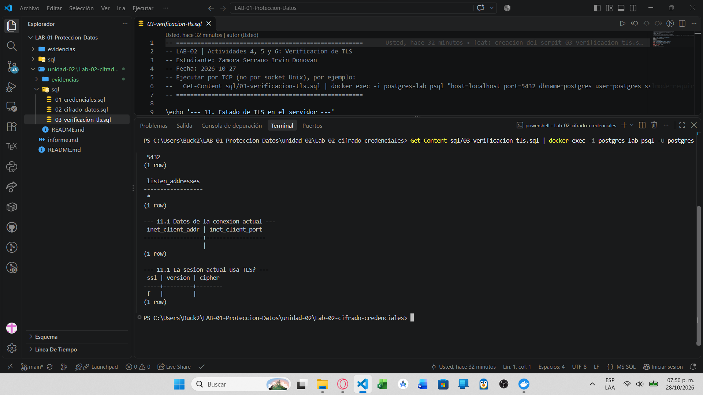

# Evidencia 04 — TLS en PostgreSQL

**Estudiante:** Zamora Serrano Irvin Donovan | **Fecha:** 2026-10-27

## Objetivo
Verificar el estado real de TLS en PostgreSQL 16 (Docker), habilitarlo con un certificado autofirmado de laboratorio y comparar conexiones con y sin TLS.

## Comando o procedimiento
> La imagen oficial `postgres:16` trae `ssl = off` por defecto. La llave privada se genera **dentro del contenedor** y no se guarda en el repositorio.

**1. Estado inicial**
```powershell
docker exec postgres-lab psql -U postgres -c "SHOW ssl;"
```
**2. Generar certificado autofirmado (CN=localhost)**
```powershell
docker exec postgres-lab openssl version
docker exec -u root postgres-lab sh -c "openssl req -new -x509 -days 365 -nodes -text -out /var/lib/postgresql/server.crt -keyout /var/lib/postgresql/server.key -subj '/CN=localhost' && chown postgres:postgres /var/lib/postgresql/server.crt /var/lib/postgresql/server.key && chmod 600 /var/lib/postgresql/server.key && chmod 644 /var/lib/postgresql/server.crt"
```
(Si `openssl` no existe: `docker exec -u root postgres-lab sh -c "apt-get update && apt-get install -y openssl"`.)

**3. Activar TLS y reiniciar**
```powershell
docker exec postgres-lab psql -U postgres -c "ALTER SYSTEM SET ssl = 'on';" -c "ALTER SYSTEM SET ssl_cert_file = '/var/lib/postgresql/server.crt';" -c "ALTER SYSTEM SET ssl_key_file = '/var/lib/postgresql/server.key';"
docker restart postgres-lab
```
**4. Verificar con `03-verificacion-tls.sql` (conexión TCP con TLS)**
```powershell
Get-Content unidad-02/lab-02-cifrado-credenciales/sql/03-verificacion-tls.sql | docker exec -i postgres-lab psql "host=localhost port=5432 dbname=postgres user=postgres sslmode=require"
```
**5. Comparación sin TLS, `require` y `verify-full`**
```powershell
docker exec postgres-lab psql "host=localhost port=5432 dbname=postgres user=postgres sslmode=disable" -c "SELECT ssl, version, cipher FROM pg_stat_ssl WHERE pid = pg_backend_pid();"
docker exec postgres-lab psql "host=localhost port=5432 dbname=postgres user=postgres sslmode=require" -c "SELECT ssl, version, cipher FROM pg_stat_ssl WHERE pid = pg_backend_pid();"
docker exec postgres-lab psql "host=localhost port=5432 dbname=postgres user=postgres sslmode=verify-full sslrootcert=/var/lib/postgresql/server.crt" -c "SELECT ssl, version, cipher FROM pg_stat_ssl WHERE pid = pg_backend_pid();"
```
Opcional (debe fallar por no coincidir el nombre): repetir `verify-full` con `host=127.0.0.1`.

## Resultado obtenido
**Estado inicial (`SHOW ssl;`):**


**Salida de `03-verificacion-tls.sql` por el socket Unix (estado sin TLS: `ssl = off`):**


**Sesión interactiva por el socket Unix: `ssl = f` (sin TLS):**


**Segunda ejecución del script, también sin TLS:**


> **Pendiente de evidencia:** las capturas anteriores muestran el estado *sin* TLS. Tras activar `ssl = on` (pasos 2 y 3) falta capturar la conexión TCP con `sslmode=require` y con `sslmode=verify-full` mostrando `ssl = t`, la versión y el cipher, y actualizar el análisis siguiente con esos valores.

## Análisis
- **¿La conexión actual usa TLS?** No. `SHOW ssl;` devuelve `off` (la imagen `postgres:16` lo trae apagado) y `pg_stat_ssl` muestra `ssl = f` en las sesiones por socket Unix.
- **Versión de TLS:** vacía mientras no hay TLS; `ssl_min_protocol_version` está en `TLSv1.2`.
- **Algoritmo de cifrado:** vacío mientras no hay TLS. Con TLS activo, `version` y `cipher` aparecerán en la misma consulta a `pg_stat_ssl`.
- **Con TLS vs sin TLS:** sin TLS, las consultas y resultados viajan en claro y pueden ser observados o modificados por quien vea la red. Con TLS hay confidencialidad, integridad y, con validación de certificado, autenticación del servidor.
- **Modos de `sslmode`:**

| Modo | Qué garantiza |
|---|---|
| `disable` | Sin TLS |
| `prefer` | Intenta TLS pero acepta conexión sin cifrar |
| `require` | Exige TLS, sin verificar la identidad del servidor |
| `verify-ca` | TLS + certificado firmado por una CA de confianza |
| `verify-full` | Lo anterior + el nombre del servidor coincide con el certificado |

## Conclusión
TLS protege los datos en tránsito, pero no sustituye la autorización de PostgreSQL ni protege los datos almacenados. Para validar con quién nos conectamos hace falta `verify-full`; `require` solo cifra.
