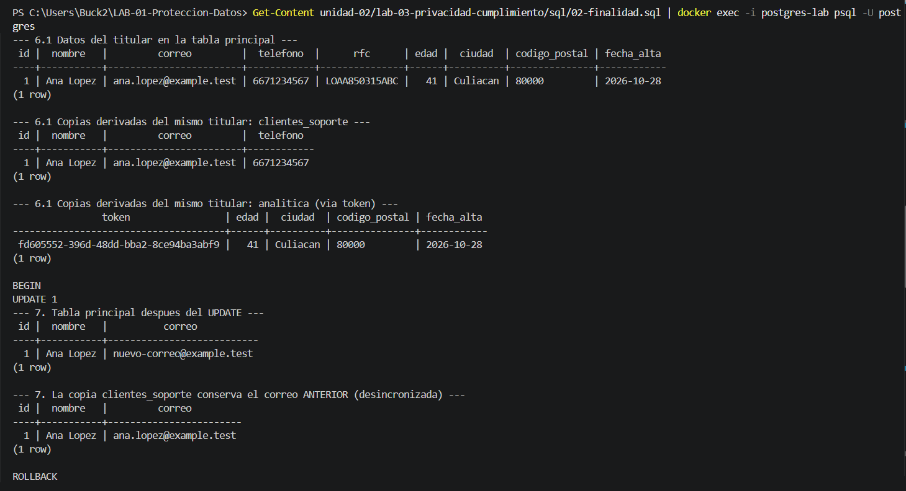
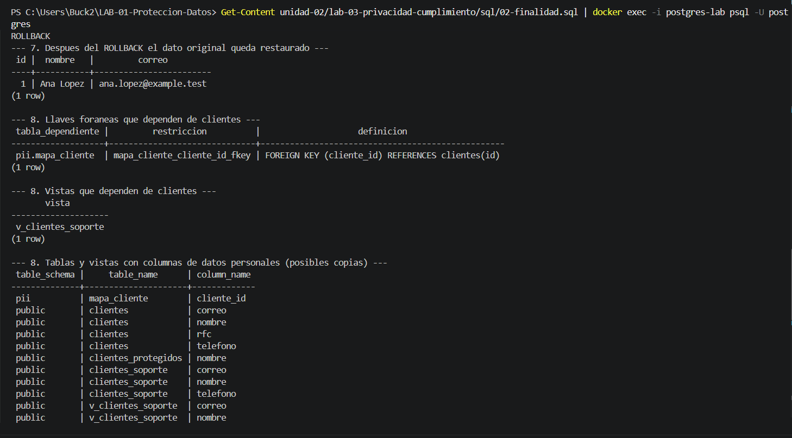

# Evidencia 06 — Análisis de derechos ARCO

**Estudiante:** Zamora Serrano Irvin Donovan | **Fecha:** 2026-10-31

## Objetivo
Identificar las implicaciones técnicas que tienen en la base de datos las solicitudes de acceso, rectificación, cancelación y oposición (ARCO), sin resolver el aspecto jurídico, que corresponde a las áreas de privacidad y cumplimiento.

## Procedimiento
Se ejecutó la sección de las Actividades 6, 7 y 8 de `sql/02-finalidad.sql`:
```powershell
Get-Content sql/02-finalidad.sql | docker exec -i postgres-lab psql -U postgres
```
- **Acceso (Actividad 6):** consulta por correo sobre `clientes` y búsqueda del mismo titular en las copias derivadas (`clientes_soporte` y `analitica.clientes` mediante el token de `pii.mapa_cliente`).
- **Rectificación (Actividad 7):** `UPDATE` del correo dentro de `BEGIN ... ROLLBACK`, para no alterar los datos del LAB-01.
- **Cancelación (Actividad 8):** análisis de dependencias y copias, **sin ejecutar `DELETE`** (detalle en `08-ciclo-vida.md`).
- **Oposición (Actividad 9):** análisis conceptual, sin comandos.

## Resultado

### Acceso
La consulta localizó al titular en la tabla principal (`id`, `nombre`, `correo`, `telefono`, `rfc`, `edad`, `ciudad`, `codigo_postal`, `fecha_alta`) y también en dos copias derivadas:

| Ubicación | Datos del titular | ¿Cómo se localiza? |
|---|---|---|
| `clientes` | Todos los campos | Por correo |
| `clientes_soporte` | `id`, `nombre`, `correo`, `telefono` | Por correo |
| `analitica.clientes` | `edad`, `ciudad`, `codigo_postal`, `fecha_alta` bajo un token | **Solo** a través de `pii.mapa_cliente` (el token no contiene el correo) |



### Rectificación
Dentro de la transacción, `UPDATE 1` cambió el correo del titular en `clientes`. En el mismo momento, `clientes_soporte` **conservó el correo anterior**: la copia quedó desincronizada. Después del `ROLLBACK` el dato original quedó restaurado.



### Cancelación
Se identificó que `pii.mapa_cliente` depende de `clientes` mediante una llave foránea y que existen copias en `clientes_soporte`, `analitica.clientes` y en la vista `v_clientes_soporte`. El análisis completo del ciclo de vida está en `08-ciclo-vida.md`. No se ejecutó ningún `DELETE`.

### Oposición
Análisis conceptual (ver más abajo).

## Análisis

| Derecho | Qué solicita el titular | Implicación técnica | Qué debe escalarse a otras áreas |
|---|---|---|---|
| **Acceso** | Conocer qué datos tiene la organización | Localizar sus datos en **todas** las tablas y copias (no solo en `clientes`); identificar copias seudonimizadas mediante el mapa de tokens; entregar la información legible; verificar la identidad del solicitante | Qué información adicional debe entregarse y en qué plazo |
| **Rectificación** | Corregir un dato inexacto | Actualizar el dato y **propagar el cambio a las copias** (`clientes_soporte` quedó desincronizada); registrar quién, cuándo y qué valor anterior y nuevo | Verificar la autorización y la procedencia de la corrección |
| **Cancelación** | Que se eliminen sus datos cuando proceda | Revisar dependencias (llave foránea de `pii.mapa_cliente`), copias derivadas, respaldos, réplicas, exportaciones y sistemas externos; eliminar con un procedimiento documentado y no con un solo `DELETE` | Determinar si procede (por ejemplo, por obligaciones fiscales) y aprobar |
| **Oposición** | Que sus datos no se usen para una finalidad | Separar finalidades mediante preferencias, vistas y roles; excluirlo de campañas y exportaciones | Decidir si procede la oposición |

### Preguntas de las actividades

**Actividad 6 — ¿Qué información adicional debería proporcionar la organización además del resultado de la consulta?**
Las finalidades del tratamiento, el origen de los datos, a quién se comparten o transfieren, los plazos de conservación y cómo ejercer los demás derechos. Técnicamente, además hay que verificar la identidad del solicitante, registrar la solicitud y localizar los datos en las copias derivadas.

**Actividad 7**
1. *¿Cómo podría comprobarse que el cambio fue autorizado?* Con una solicitud documentada, verificación de identidad y aprobación del responsable, conservadas como evidencia.
2. *¿Debería registrarse quién realizó el cambio?* Sí: usuario, fecha y hora, valor anterior y valor nuevo.
3. *¿Por qué será importante la trazabilidad?* Permite demostrar que el cambio fue legítimo, detectar modificaciones no autorizadas y reconstruir lo ocurrido (tema de la Unidad III).

**Actividad 9 — ¿Es necesario eliminar inmediatamente todos los datos del titular que se opone?**
No.
1. *Qué podría mantenerse:* lo necesario para la finalidad principal y para obligaciones legales, como la relación comercial y la facturación.
2. *Qué dejaría de usarse:* los datos para la finalidad secundaria a la que el titular se opone (por ejemplo, promociones).
3. *Mecanismos técnicos:* una columna o tabla de preferencias con fecha (`acepta_promociones`), vistas y roles separados por finalidad, y exclusión en campañas y exportaciones a terceros.
4. *Por qué no decide solo el DBA:* procedencia, base jurídica y alcance son decisiones del área jurídica, del responsable de privacidad y del propietario del dato; el DBA identifica las implicaciones técnicas y las implementa.

## Conclusión
Las solicitudes ARCO no se resuelven con una consulta aislada: exigen conocer **dónde** viven los datos de una persona (tablas, copias seudonimizadas, respaldos, exportaciones), mantener las copias consistentes y registrar cada acción. El DBA aporta la localización y la ejecución técnica, y escala las decisiones jurídicas y de finalidad a quien corresponde.
