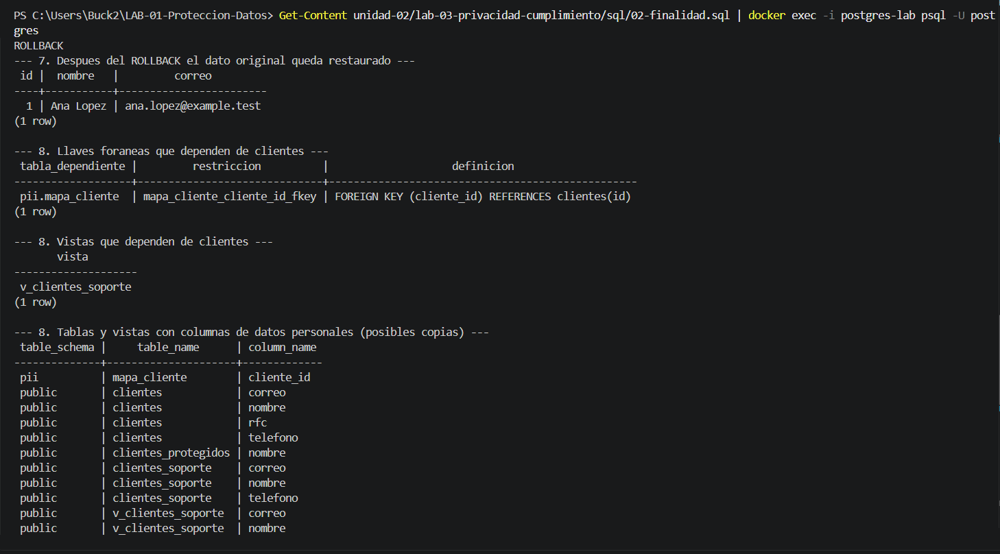
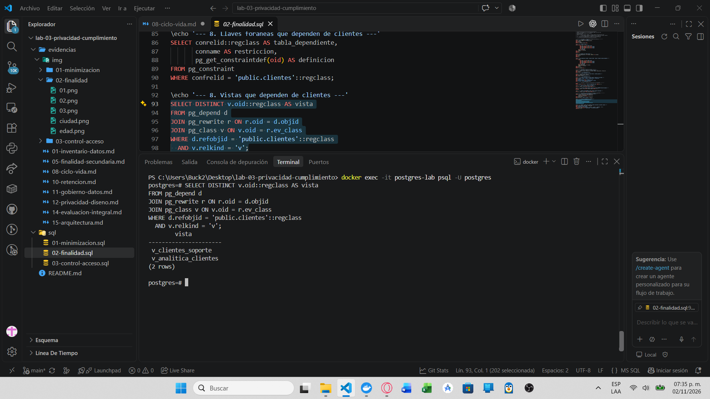
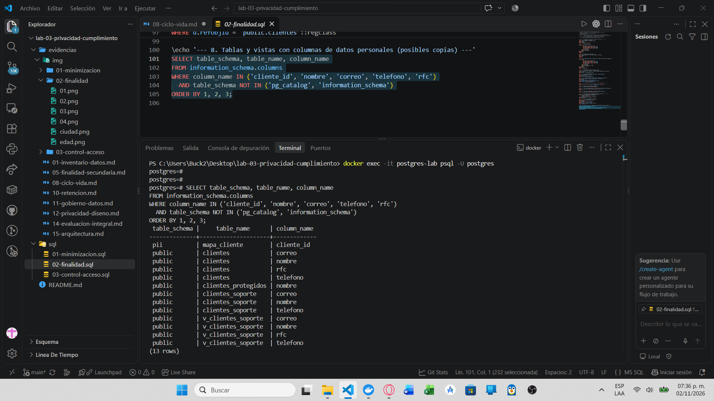

# Evidencia 08 — Ciclo de vida y derecho de cancelación

**Estudiante:** Zamora Serrano Irvin Donovan | **Fecha:** 2026-10-31

## Objetivo
Analizar qué otros lugares contienen datos de un cliente antes de atender una solicitud de cancelación, **sin ejecutar un `DELETE`** sobre la tabla principal.

## Procedimiento
Consultas de solo lectura (sección "Actividad 8" de `sql/02-finalidad.sql`):
```powershell
Get-Content sql/02-finalidad.sql | docker exec -i postgres-lab psql -U postgres
```
Se buscan llaves foráneas, vistas y tablas/columnas que contienen datos personales.

## Resultado

**Llaves foráneas que dependen de `clientes`:**


**Vistas que dependen de `clientes`:**


**Tablas y vistas con columnas de datos personales:**


**Mapa de ciclo de vida:**
```
clientes
 ├── pii.mapa_cliente          (llave foránea hacia clientes.id)
 ├── analitica.clientes        (copia seudonimizada: token, edad, ciudad, CP)
 ├── clientes_soporte          (copia de nombre, correo y teléfono)
 ├── clientes_protegidos / otras tablas de laboratorio (RFC cifrado, si existen)
 ├── vistas (v_clientes_soporte, v_analitica_clientes)   → no copian datos
 ├── respaldos                 (copias completas de la base)
 ├── réplicas                  (copias en servidores secundarios)
 ├── registros de auditoría y logs
 ├── reportes y exportaciones  (CSV, hojas de cálculo)
 ├── copias de desarrollo y pruebas
 └── sistemas externos         (proveedores, campañas, facturación)
```

## Análisis
**¿Por qué eliminar un registro de `clientes` no elimina toda la información de esa persona?**
- La llave foránea de `pii.mapa_cliente` impediría el `DELETE` hasta resolver esa dependencia, y al borrarla se pierde el vínculo token→persona.
- Las copias derivadas (`clientes_soporte`, `analitica.clientes`) conservan datos aunque se borre el original.
- Los respaldos y las réplicas contienen el registro hasta que expiren o se reconstruyan.
- Logs, auditoría, exportaciones, copias de desarrollo y sistemas externos mantienen datos fuera de la tabla.
- Un dato seudonimizado puede seguir asociado a la persona mientras exista el mapa.

Por eso la cancelación debe tratarse como un **proceso** con inventario, orden de eliminación, tratamiento de respaldos (por ejemplo, ciclo de vida de las copias) y evidencia, no como un comando.

## Conclusión
Antes de cancelar hay que conocer todos los lugares donde viven los datos. Sin un inventario y un mapa del ciclo de vida, la eliminación es incompleta y no verificable.
