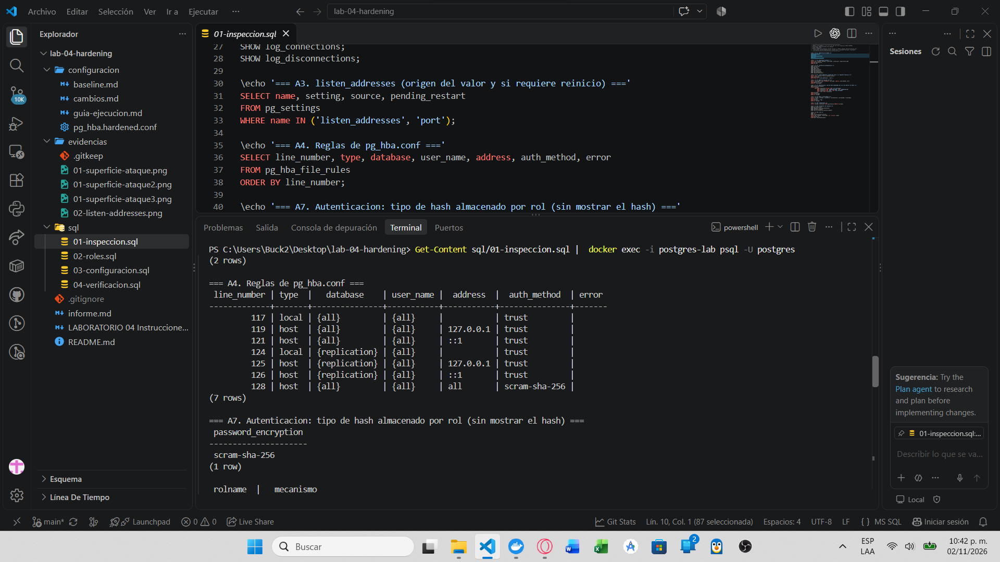

# Registro de cambios y comparación — LAB-04

**Estudiante:** Zamora Serrano Irvin Donovan | **Fecha:** 2026-11-01

## 1. Comparación antes y después (Actividad 16)

| Control | Antes | Después | Justificación |
|---|---|---|---|
| listen_addresses | `*` (origen `configuration file`) | Objetivo `localhost`: ya con `ALTER SYSTEM`, pero V1 muestra `*` y `pending_restart = t`; **falta reiniciar** | Un servidor accesible solo desde el contenedor no expone el puerto a otras redes |
| pg_hba.conf | 7 reglas: `local all all trust`; `host all all 127.0.0.1 trust` y `::1 trust`; 3 reglas `replication` con `trust`; `host all all all scram-sha-256` | `pg_hba.hardened.conf` (base + usuario + origen y `reject` explícito) **preparado; V2 aún muestra las 7 reglas originales** | Evita una regla amplia como `all` y deja solo lo necesario |
| Método de autenticación | `trust` en local y loopback; `scram-sha-256` solo en `host all all all`; `password_encryption = scram-sha-256` | Objetivo: `scram-sha-256` en TCP y `trust` solo en el socket local de `postgres` (pendiente de aplicar con `pg_hba`); `password_encryption` sin cambio | `trust` en TCP permite entrar sin contraseña |
| Usuarios administrativos | `postgres` (`rolsuper = t`), único con `LOGIN` | `postgres` sigue siendo el único superusuario (V3) | Las aplicaciones no usan cuentas con privilegios altos |
| Cuentas de aplicación | Ninguna (solo `analista` y `soporte`, `NOLOGIN`) | `app_user` (límite 10) y `consulta_user` (límite 5), sin `SUPERUSER`/`CREATEROLE`/`CREATEDB` (V3) | Limita el impacto si una cuenta se compromete |
| Puerto | `5432` | `5432` (sin cambio) | Cambiar el número de puerto no sustituye autenticación, autorización ni firewall |
| TLS | `ssl = off`; `ssl_min_protocol_version = TLSv1.2` | `ssl = off` (V1). Las reglas `hostssl` exigen activar TLS antes; si sigue apagado, usar `host` y documentarlo como pendiente | Protege credenciales y datos en tránsito |
| Permisos SO | No se capturó `ls -l` | Pendiente: `chown`/`chmod 600` de `pg_hba.conf` y verificación con `ls -l` | Evita lectura o modificación por otros usuarios del sistema |
| Extensiones | `pgcrypto 1.3`, `plpgsql 1.0` | Sin cambio (V5); solo las necesarias para las prácticas | Menos funcionalidad habilitada, menos superficie |
| Conexiones | `log_connections` y `log_disconnections` en `off`; `idle_in_transaction_session_timeout = 0` (sin límite) | `log_connections` y `log_disconnections` en `on`, `statement_timeout` 5 min (`300000`), `idle_in_transaction_session_timeout` 60 s (`60000`), límites por rol (V1, V3) | Evita consumo indefinido de recursos |

## 2. Registro de cambios

| # | Cambio | Comando o archivo | Motivo | Verificación | Reversión |
|---|---|---|---|---|---|
| 1 | Roles `app_user` y `consulta_user` | `sql/02-roles.sql` | Separar cuentas por función | `04-verificacion.sql` (V3, V4) | `DROP OWNED BY` + `DROP ROLE` |
| 2 | `REVOKE CONNECT ... FROM PUBLIC` | `sql/02-roles.sql` | Solo cuentas autorizadas se conectan | Intento con usuario no autorizado | `GRANT CONNECT ... TO PUBLIC` |
| 3 | Reglas `pg_hba.conf` específicas (**pendiente de aplicar**) | `configuracion/pg_hba.hardened.conf` | Reducir orígenes y exigir TLS y SCRAM | `pg_hba_file_rules` sin errores; pruebas TCP | Restaurar `pg_hba.conf.bak-lab04` |
| 4 | `listen_addresses = 'localhost'` (**falta reinicio**) | `sql/03-configuracion.sql` + reinicio | Eliminar exposición fuera del equipo local | `SHOW listen_addresses`, `/proc/net/tcp` | `ALTER SYSTEM RESET` + reinicio |
| 5 | Registro de conexiones | `log_connections`, `log_disconnections` | Trazabilidad | `SHOW` | `ALTER SYSTEM RESET` |
| 6 | Tiempos máximos | `statement_timeout`, `idle_in_transaction_session_timeout` | Disponibilidad | `SHOW` | `ALTER SYSTEM RESET` |
| 7 | Permisos de `pg_hba.conf` (**pendiente**) | `chown` y `chmod 600` | Protección del archivo sensible | `ls -l` | n/a |

## 3. Análisis de la regla permisiva (Actividad 5)

Regla conceptual analizada: `host all all 0.0.0.0/0 scram-sha-256`

- **Bases de datos:** todas.
- **Usuarios:** todos, incluidos los administrativos.
- **Orígenes:** cualquier dirección IPv4.
- **Método:** `scram-sha-256` (correcto como método).
- **Por qué es una exposición innecesaria:** la contraseña es la única barrera frente a cualquier origen; permite intentos de fuerza bruta desde cualquier lugar y deja accesibles bases y cuentas que no necesitan conexión remota.
- **Información necesaria para restringirla:** qué aplicaciones se conectan, desde qué direcciones o redes, con qué cuenta, a qué base de datos, y si el entorno soporta TLS.

| Elemento | Valor |
|---|---|
| Regla actual | `host all all 0.0.0.0/0 scram-sha-256` (conceptual); en este laboratorio la regla equivalente es la de la imagen: `host all all all scram-sha-256` |
| Problema | Cualquier origen, base y usuario pueden intentar autenticarse |
| Origen que realmente necesita acceso | Solo la propia máquina (`127.0.0.1`, `::1`) |
| Base de datos | `postgres` (la base de las prácticas) |
| Usuario | `app_user` y `consulta_user`; administración con `postgres` |
| Regla propuesta | `hostssl postgres app_user 127.0.0.1/32 scram-sha-256` (y equivalentes), con `reject` final |

## 4. Reglas aplicadas (Actividad 6)
Ver `pg_hba.hardened.conf`: cada regla combina base de datos, usuario, origen y método. La regla restringe **qué** cuenta entra, **a dónde**, **desde dónde** y **cómo** se autentica.

## 5. Estado inicial de `pg_hba.conf`
Siete reglas (líneas 117 a 128): `local all all trust`, `host all all 127.0.0.1 trust`, `host all all ::1 trust`, tres reglas de `replication` con `trust` y `host all all all scram-sha-256`; la columna `error` está vacía.

## 6. Extensiones revisadas (Actividad 10)
| Extensión | ¿Necesaria? | Origen / comentario |
|---|---|---|
| `plpgsql` | Sí | Incluida por defecto |
| `pgcrypto` | Para las prácticas | Instalada en LAB-01/LAB-02; en otro entorno se habilitaría solo si se necesita cifrado en la base |

## 7. Parámetros de conexión (Actividad 11)
| Parámetro | Función | Valor antes | Valor después |
|---|---|---|---|
| `max_connections` | Máximo de conexiones simultáneas | No capturado | sin cambio |
| `superuser_reserved_connections` | Conexiones reservadas para superusuarios (acceso de emergencia) | No capturado | sin cambio |
| `statement_timeout` | Cancela sentencias que superan el tiempo | No capturado | 5 min (`300000`) |
| `idle_in_transaction_session_timeout` | Termina sesiones con una transacción abierta sin actividad | `0` (sin límite) | 60 s (`60000`) |

**¿Por qué mantener conexiones indefinidamente abiertas es un problema?** Consumen memoria y ranuras de conexión, pueden retener bloqueos y tardar en liberar recursos; en el límite agotan `max_connections` y causan una negación de servicio.

## 8. Política de firewall conceptual (Actividad 14)
No se modificó ningún firewall. Diseño para PostgreSQL en `10.10.10.20:5432`:

| Origen | Destino | Puerto | Acción |
|---|---|---|---|
| 10.10.10.0/24 (red DBA) | PostgreSQL | 5432 | Permitir |
| Cualquier otro origen | PostgreSQL | 5432 | Denegar |

**¿Por qué `pg_hba.conf` y el firewall no son equivalentes?** El firewall decide si un paquete llega al puerto (control de red, antes de PostgreSQL). `pg_hba.conf` decide, una vez llegada la conexión, si ese usuario puede autenticarse en esa base y con qué método. Son capas distintas y complementarias: sin firewall, cualquiera alcanza el servicio; sin `pg_hba.conf`, cualquiera que llegue puede intentar autenticarse.
